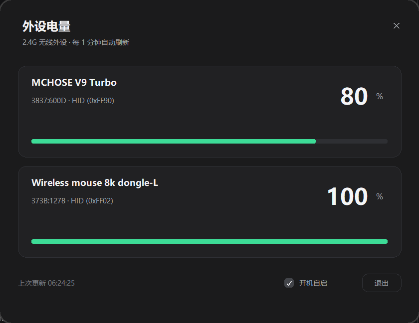

# 2.4G 外设电量

Windows 10/11 的 2.4G 无线外设电量托盘工具。纯 Python 标准库（`ctypes` + `tkinter`），零第三方依赖。



托盘里每台设备一个电量圆环：


## 下载

- **免安装**：到 [Releases](https://github.com/Ap0LoG1zE/EZ2.4G/releases) 下载 `2.4G.exe`，双击运行。
- **源码**：下载 `my_devices.py`，安装 Python 3.10+ 后运行：

```bat
python my_devices.py
```

## 用法

```bat
python my_devices.py            :: 托盘常驻
python my_devices.py --once     :: 读一次并打印
python my_devices.py --list     :: 列出 HID 接口
python my_devices.py --panel    :: 只开面板
python my_devices.py --install  :: 开机自启 + 桌面入口
```

配置在 `%APPDATA%\BatteryTray\config.json`，保存已添加设备、协议、上次电量和刷新间隔。

## 功能

- 托盘常驻，左键刷新，右键打开面板
- 插入新设备时弹窗确认添加，显示设备名、VID:PID 和电量
- 双击设备名重命名；右键卡片删除设备（同时清掉它的协议和上次电量）
- 设备休眠时显示上次电量，标注「上次更新 HH:MM」
- 开机自启、自动刷新、只读查询

## 支持的协议

读取顺序：**标准 HID → 厂商协议 → 抓包协议**。前两者来自内置表，第三条是用户自己抓包学到的。

| 设备 | VID:PID | 协议 |
|---|---|---|
| ATK A9 Air（鼠标） | `373B:1278` | 17 字节，`08 04 … 49`，电量 `[6]` |
| ATK N9V2（耳机） | `373B:1262` | 64 字节，`55 65 <电量> <状态>` |
| MCHOSE V9 Turbo+ | `3837:600A` | 同上 |
| MCHOSE V9 Turbo | `3837:600D` | 同上 |
| MCHOSE Z75S（键盘） | `258A:01BB` | 20 字节，report `0x13`，cmd `0x4A`，末字节校验和，电量 `[5]` |
| 达尔优 A950 | `260D:1175` | 17 字节，方案同 ATK，电量 `[6]` |
| VXE | `373B:10C9` | 同上 |
| Imecoo | `3554:FB34` | 同上 |
| 西伯利亚 T7 | `36F9:*` | 64 字节，`55 65 00`，电量 `[3]` |
| 雷柏 VT3S | `24AE:1411` | 19 字节，设备主动上报，电量 `[8]` |

以上协议参数来自 [sdparklab/Voltide](https://github.com/sdparklab/Voltide)（MIT）。

## 未知设备抓包

需要 [USBPcap](https://desowin.org/usbpcap/) 和管理员权限。

1. 关闭厂家驱动（托盘也退出）
2. 点「开始抓包」，允许管理员权限
3. 打开厂家驱动，让它显示一次电量，记下数字
4. 点「停止」，填入那个电量
5. 只有一个字节符合 → 直接保存
6. 多个字节符合 → 换一个相差 10% 以上的电量再抓一次，按差值匹配

保存后立即回读验证：先发请求，失败则被动监听输入报告；仍失败会删除协议并提示「抓包中不含电量数据」。

分析时会过滤描述符、EP0 标准控制请求、字符串描述符和全零报告；HID Feature Report 和厂商自定义报告保留。

## 限制

- 仅 Windows 10/11 x64
- 电量由设备上报，可能是 5% 步进
- 加密或私有握手协议无法通过抓包获取
- 圆角用 `SetWindowRgn` 裁剪，边缘有锯齿（Tk 无抗锯齿）

## 文件

- `my_devices.py`：主程序（抓包助手已内置）
- `app.ico`：图标
- `docs/panel.png`、`docs/tray.png`：截图

## 许可证

[MIT](LICENSE)
