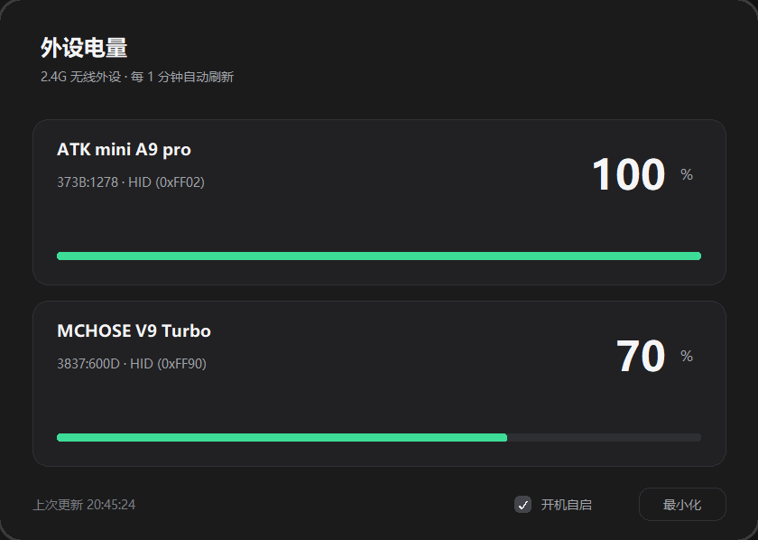

# 外设电量

Windows 10/11 的 2.4G 无线外设电量托盘工具。

纯 Python 标准库（`ctypes` + `tkinter`），**零第三方依赖**，不写日志，退出即清理。



## 下载

两种方式任选：

- **免安装（推荐）**：到 [Releases](https://github.com/Ap0LoG1zE/EZ2.4G/releases) 下载 `外设电量.exe`，双击运行，无需 Python。
- **最小体积**：下载 `my_devices.py`（约 150 KB），安装 Python 3.10+ 后运行：

```bat
python my_devices.py
```

> exe 未签名，Windows 可能提示 SmartScreen，选择“更多信息 → 仍要运行”。

## 功能

- 托盘常驻，左键刷新，右键打开面板
- 启动不自动添加设备；无设备时显示「请插入设备 / 或者拔插一下你想要添加的设备」
- 插入或重新拔插设备时弹窗确认，显示设备名、VID:PID 和当前电量
- 双击卡片上的设备名即可重命名，名称保存在配置里
- 右键设备卡片可删除该设备
- 深色圆角面板、电量卡片、滚动列表、托盘电量图标
- 已收录设备开箱即用，未知设备可抓包学习协议
- 自动刷新、开机自启、桌面快捷方式
- 只读查询，不修改设备设置

## 环境

- Windows 10/11 x64
- Python 3.10+（需包含 tkinter）
- 未知设备抓包时需要 [USBPcap](https://desowin.org/usbpcap/) 和管理员权限

## 运行

```bat
python my_devices.py            :: 托盘常驻
python my_devices.py --once     :: 读一次并打印
python my_devices.py --list     :: 列出 HID 接口
python my_devices.py --panel    :: 只开面板，不常驻托盘
python my_devices.py --install  :: 创建开机自启 + 桌面入口
```

配置文件：`%APPDATA%\BatteryTray\config.json`  
刷新间隔、设备名、USBPcap 路径、抓包学到的协议都在这里。

## 未知设备抓包

1. 安装 USBPcap，重启电脑
2. 插拔一次要抓包的设备，在弹窗里点「添加」
3. **关闭厂家驱动**，点「开始抓包」并允许管理员权限
4. 打开厂家驱动，让它显示一次电量，记下数值
5. 点「停止」，填入刚才的电量
6. 只有一个字节符合：直接保存这个字节作为电量
7. 多个字节符合：换一个不同电量再抓一次，对比两次字节差值

提示：

- 没有匹配：按说明重试，注意抓包期间厂家驱动必须显示过电量；
- 匹配不准确：换一个相差 10% 以上的电量再抓；
- 多次没有结果：可能是厂家协议加密，无法通过抓包获取。

## 已收录设备

| 设备 | VID:PID | 协议 |
|---|---|---|
| ATK 蜻蜓 A9 mini 大师版（无线） | `373B:1278` | HID `0xFF02`，17 字节，`08 04` 请求，电量 `resp[6]` |
| ATK 蜻蜓 A9 mini 大师版（有线） | `373B:128E` | 同上，`resp[7] != 0` 表示有线 |
| MCHOSE V9 Turbo | `3837:600D` | HID `0xFF90`，64 字节，`55 65 01` → `55 65 <电量> 02` |

其他设备可通过抓包学习；每个设备的协议按 VID:PID 保存在配置文件里。

## 限制

- 电量由设备上报，可能是 5% 步进
- 加密或私有握手协议无法通过抓包读取
- 仅支持 Windows 10/11 x64

## 文件

- `my_devices.py`：主程序（抓包助手已内置）
- `app.ico`：图标
- `启动.bat`：启动脚本
- `docs/panel.png`：界面截图
